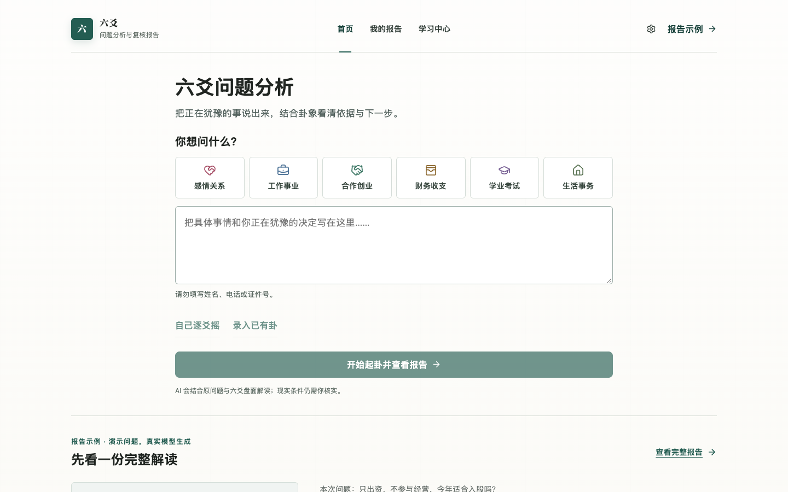
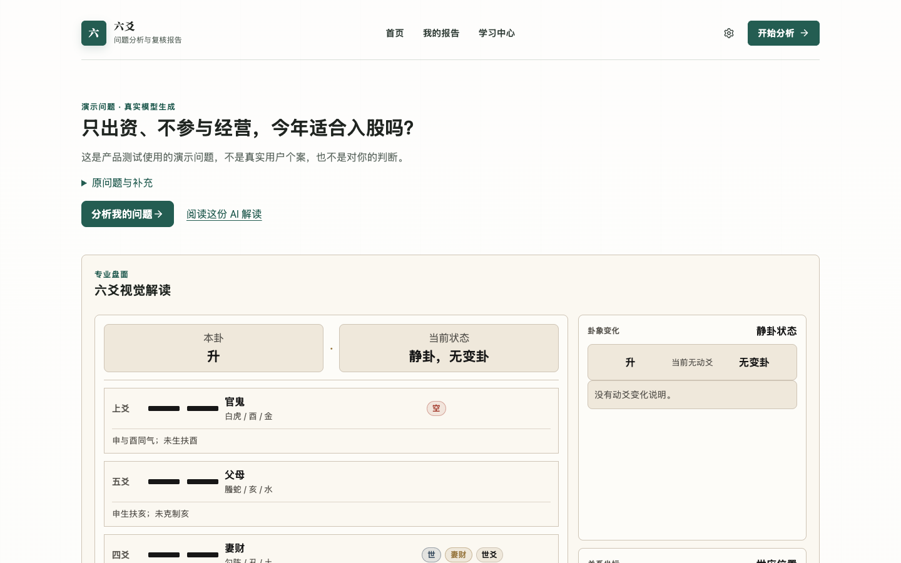
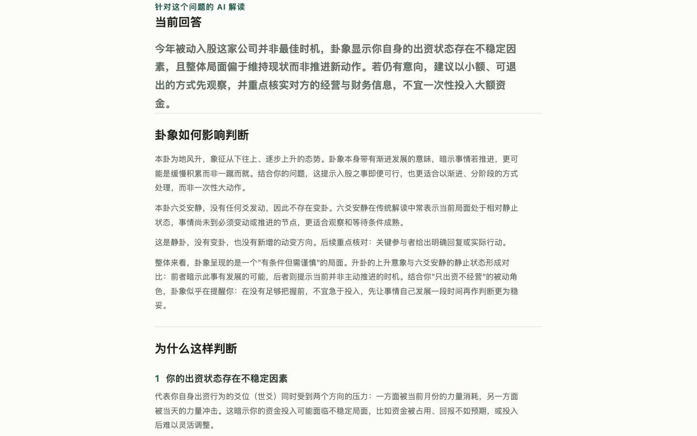

# SIX · 六爻问题分析

SIX 是一个围绕具体问题的六爻学习与报告应用。用户写下正在考虑的事情，系统记录起卦时间与六爻盘面，使用确定性规则生成可复核的事实，再由 AI 结合原问题解释卦象、判断依据和现实中值得核实的条件。

六爻属于传统文化解释。报告不保证现实结果，也不替代医疗、法律、财务等专业意见。AI 解释不会重新排盘；现实情况仍需用户自行核实。

## 界面预览

| 提问与起卦 | 报告示例 |
| --- | --- |
|  |  |



截图来自当前仓库的本地界面。报告截图使用[仓库内的演示问题](apps/web/app/example/report.json)，不包含真实用户报告。演示问题的模型输出已保存为样例数据；实际提问需要配置真实 AI 服务。

## 可以做什么

- 从感情、工作、合作、财务、学业及生活事项进入，也可以直接输入自己的问题；场景入口不是强制分类。
- 选择系统代摇、逐爻摇卦，或录入已有的六爻与原起卦时间。
- 查看本卦、动爻、变卦、世应、六亲及计算依据；静卦标记为无变卦。
- 在有真实模型配置时生成针对问题的 AI 解读，查看行动建议，并从关键判断定位到关联证据和爻位。
- 在当前浏览器查看自己的报告，下载文本或 SVG，并浏览学习中心的教程、知识卡和问答。

## 本地运行

需要 Node.js 20、`pnpm@9.15.4`。以下方式可先查看界面和确定性排盘，AI 解读保持不可用，报告暂存于 API 进程内存中。

```bash
pnpm install
```

分别打开两个终端：

```bash
API_PORT=4000 AI_PROVIDER=disabled pnpm dev:api
```

```bash
PORT=3200 NEXT_PUBLIC_API_BASE_URL=http://127.0.0.1:4000/api/v1 pnpm dev:web
```

访问 <http://localhost:3200>。可直接打开 <http://localhost:3200/example> 查看无需 API 密钥的完整演示报告。

需要持久化报告和队列时，使用独立的 PostgreSQL、Redis 与数据库迁移。完整步骤见[本地启动指南](docs/development/local-startup.md)；现有数据迁移与备份见[备份指南](docs/development/backup-and-migration.md)。Docker Compose 只启动 PostgreSQL 与 Redis，Web/API 仍由本地 Node.js 进程运行。

## 真实 AI 解读

将 `.env.example` 复制为仓库根目录的 `.env`，在本机设置 `DEEPSEEK_API_KEY`，然后按[启动指南](docs/development/local-startup.md#real-deepseek-mode)运行 API 与 Web。密钥只提供给服务端，**不要**放入 `NEXT_PUBLIC_*` 变量、源代码、截图或提交记录。没有配置或模型不可用时，界面会显示状态，不会用模拟解读冒充真实输出。

`.env`、`.env.*` 默认被 Git 忽略，只有不含真实密钥的 `.env.example` 可以提交。本仓库的示例数据库密码只适用于隔离的本地开发环境，部署时请自行设置独立凭据。

## 项目结构

| 路径 | 用途 |
| --- | --- |
| `apps/web` | Next.js 用户界面与报告阅读 |
| `apps/api` | NestJS API、报告保存和 AI 服务 |
| `apps/worker` | BullMQ 后台任务 |
| `apps/admin` | 内部管理界面 |
| `packages/domain` | 六爻排盘、历法、规则与报告结构 |
| `packages/database` | Prisma 模型与迁移 |
| `packages/shared` | 共享类型和校验 |
| `data`、`content` | 规则、内容与视觉资源 |

当前面向用户的产品只展示六爻。仓库中保留的梅花代码用于旧数据和接口兼容，不属于当前用户流程。

## 开发与验证

```bash
pnpm typecheck
pnpm lint
pnpm test:domain
pnpm test:contract
pnpm test:home
```

端到端测试见 `tests/e2e` 与 `playwright.config.ts`。内容导入、校验与发布状态见[内容文档](docs/content-growth/README.md)。部分文章、知识卡和 FAQ 仍处于审核状态；本地可预览的内容不等于已经获准公开发布。

## 数据与发布边界

浏览器会为匿名用户保存本地身份与未完成草稿。清除站点数据或换浏览器后，当前版本无法自动恢复报告。未连接 PostgreSQL 的开发模式会把报告暂存在 API 进程内存中，服务重启后可能丢失。

当前仓库提供本地开发与验证所需的代码和文档。公开部署还需要独立完成密钥配置、持久化、内容审核、运行环境和真实设备验收；仓库中的截图及演示报告不代表生产环境已就绪。

## 许可证

尚未选择开源许可证。公开仓库不自动授予他人复制、修改或分发代码与视觉内容的权利；正式开放复用前，需要由项目所有者选择并加入相应许可证，同时确认内容及图片资产的授权范围。
